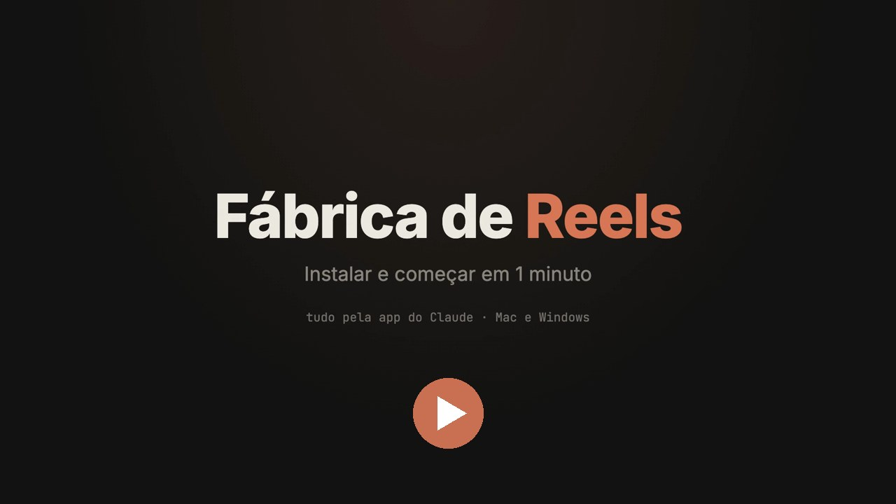

# Fábrica de Reels — plugin do Claude Code

[](https://agens-consulting.github.io/fabrica-de-reels/)

**▶ [Vê o vídeo de 1 minuto](https://agens-consulting.github.io/fabrica-de-reels/)** e instala a seguir.

Trial reels de Instagram em piloto automático. Depois de instalado, escreves `/comecar` e o Claude trata do resto contigo:

- **Todos os dias**, publica sozinho reels de texto sobre B-rolls teus, como *trial reels* (só aparecem a quem ainda não te segue).
- **Quando gravas um vídeo a falar** e o metes na Drive, o Claude edita-o: corta enganos e silêncios, põe legendas, imagens e música, escreve 2-3 hooks. Depois publica-o.
- **Cada reel oferece um recurso grátis** (um PDF com a tua estética) a quem comentar uma palavra; a DM vai sozinha.
- **De 14 em 14 dias** analisa os números, faz um relatório e melhora o que publica.

Funciona em **Mac e Windows**.

## O que precisas

1. A **app do Claude** para computador (https://claude.com/download), com sessão iniciada num plano **Pro ou Max**.
2. Conta de **Instagram profissional** (criador ou empresa).
3. Conta na **Zernio** (https://zernio.com): é ela que publica e responde aos comentários. O `/comecar` explica como criar.
4. O **código de acesso** de 6 dígitos que a Agens te deu.
5. Uns 5 GB livres no disco e o computador ligado de manhã.

## Instalar (2 minutos, tudo na app do Claude)

1. **Liga a Google Drive:** Settings → Connectors → Google Drive → Connect.
2. **Adiciona o plugin:** Customize → Plugins → **Add marketplace**, escreve `Agens-Consulting/fabrica-de-reels` e confirma.
3. Na lista aparece a **Fábrica de Reels**: carrega em **Install**.
4. Abre o separador **Code**, escreve `/comecar` (no menu aparece como `/fabrica-de-reels:comecar`) e mete o código de acesso.

O Claude guia-te pelo resto: instala o que falta, liga a Zernio e a Drive, estuda o teu perfil, aprova temas contigo, cria os primeiros recursos e mostra-te vídeos de ensaio. Demora 45-60 minutos e podes parar a meio: voltas com `/comecar`.

<details><summary>Preferes o terminal?</summary>

```
/plugin marketplace add Agens-Consulting/fabrica-de-reels
/plugin install fabrica-de-reels@fabrica-de-reels
```
</details>

## No dia a dia

| Comando | Para quê |
|---|---|
| `/reels` | Ver o que saiu, o que está agendado, avisos; resolver o que ficou à tua espera; ligar/desligar |
| `/novo-recurso <ideia ou link>` | Criar um recurso grátis novo, com palavra, automação e textos |
| Mandar um vídeo para a pasta **1. RAW** da Drive | O Claude edita-o e publica-o sozinho |
| Mandar B-rolls para a pasta **3. B-rolls** | Entram na fábrica no dia seguinte |

## Atualizar

Customize → Plugins → Fábrica de Reels → **Update** (ou, no terminal, `/plugin marketplace update fabrica-de-reels` e `/plugin update fabrica-de-reels@fabrica-de-reels`). Reinicia a app e escreve `/reels` (atualiza a tua pasta sem tocar nos teus dados).

## Privacidade

A tua chave da Zernio e as tuas configurações ficam só no teu computador, no ficheiro `.env` da tua pasta de trabalho.

**Caso de estudo (fase gratuita):** nesta fase a Fábrica de Reels é gratuita em troca de a Agens a usar como caso de estudo. Se aceitares no `/comecar`, o teu computador envia à Agens os números do teu Instagram no início e depois de 14 em 14 dias: seguidores, alcance, visualizações, as métricas de cada reel e das últimas publicações (com o início das legendas), o teu nome e o teu @. Nunca vão chaves, palavras-passe nem ficheiros. Só a Agens vê estes números. O que é enviado está todo em `ferramentas/registo.py`.

 As pastas RAW, B-rolls e Músicas da tua Drive ficam partilhadas **por link, só leitura**, para o computador as conseguir ler sozinho: só quem tiver o link as consegue abrir.

## Licenças

Fonte Montserrat (SIL Open Font License). Bandeira 🇵🇹 do Twemoji (CC-BY 4.0, © Twitter/X e colaboradores). Imagens dos vídeos vêm da Pixabay, Openverse e Wikimedia Commons, com as licenças de cada uma.
